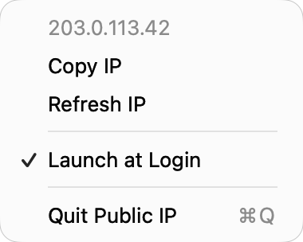

# Public IP Menu Bar for macOS

View your public IP address in the Mac menu bar. Click to copy. A small native Swift app with no account, ads or analytics.

**[Download for Apple Silicon](https://github.com/quyend-vn/publicipmenu/releases/download/v1.1.1/Public-IP-1.1.1-AppleSilicon.dmg)** · **[Universal / Intel preview](https://github.com/quyend-vn/publicipmenu/releases/download/v1.1.1/Public-IP-1.1.1-Universal.dmg)**



*Native menu with an example IP address.*

## Install

Requires **macOS 13+**. Install with Homebrew:

```sh
brew tap quyend-vn/publicipmenu https://github.com/quyend-vn/publicipmenu.git
brew install --cask quyend-vn/publicipmenu/publicipmenu
```

Or open the DMG and drag **Public IP.app** to **Applications**.

Builds are ad-hoc signed and **not notarised**; macOS may block the first launch. See [Apple's guidance](https://support.apple.com/en-gb/102445). Universal includes Apple Silicon and Intel; Intel runtime testing is pending.

## Use

- **Click** the menu bar IP to copy it.
- **Right-click** to refresh, toggle Launch at Login or quit.
- Refreshes automatically about every minute. Launch at Login is on by default.
- Runs in the menu bar, with no Dock icon or main window.

## Build from source

Requires Xcode Command Line Tools. Quit any running copy first.

```sh
./build.sh
open "/Applications/Public IP.app"
```

Builds for the current Mac architecture and installs in `/Applications`.

IP checks use [checkip.amazonaws.com](https://checkip.amazonaws.com/); VPN or proxy routing may affect the result.

[MIT License](LICENSE)
